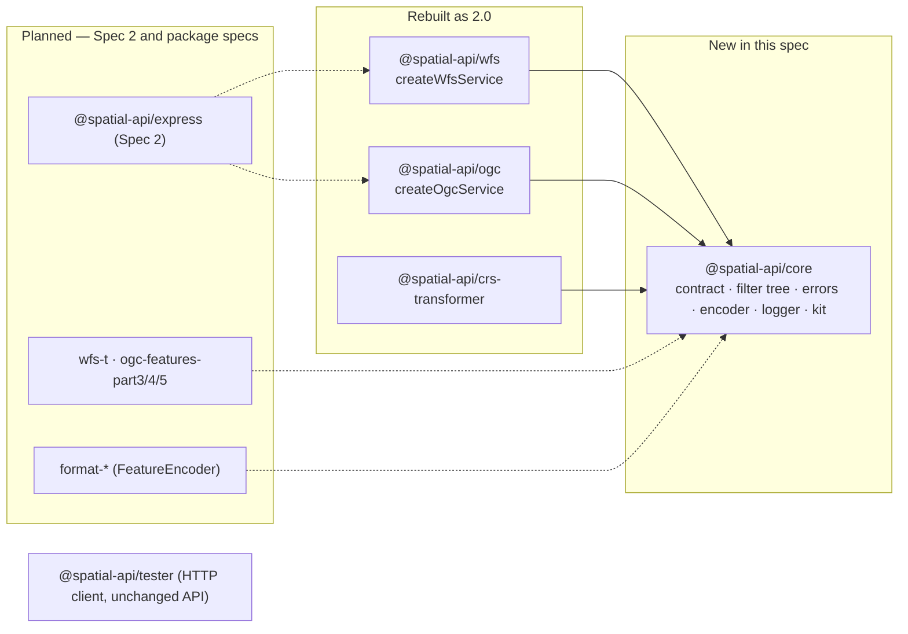

# Spatial-api 2.0 Provider Contract

> Source brief: [`briefs/2026-10-20-spatial-api-2-provider-contract.md`](briefs/2026-10-20-spatial-api-2-provider-contract.md). Its Resolved-unknowns table is binding and is not repeated here.
> Prerequisite: epic E is merged before Phase 1 starts. E closes the `[GAP]` conformance tests and runs as cezar task `1f6ea890`, branch `cez/1f6ea890`.
> Follow-ups: Spec 2 (registry, extensions, `@spatial-api/express` host, mounting rules, landing page, standalone export endpoint); one spec per protocol or format package.

## 📝 TLDR

Provider authors and every future protocol or format package need one data contract. Today `ogc` and `wfs` each define their own diverged `SpatialDataProvider`, pass an untyped MongoDB-style filter, and `ogc` exists only as an Express router.

**Proposed (future behaviour):** a new package, `@spatial-api/core`, defines one capability-based provider interface. It has:
- typed parameter objects, which are protocol-neutral
- a CQL2-JSON-based filter tree with in-memory fallback
- a format-encoder contract
- shared errors and a logging contract
- a provider conformance kit

`wfs`, `ogc` and `crs-transformer` are rebuilt on it as 2.0 framework-agnostic services. Publishing 2.0 is held until the Spec 2 host exists.

## 📝 Problem Statement

1. **The two provider interfaces have drifted.**
   - `packages/ogc/src/types.ts` has `countFeatures`, `getCollectionsMetadata` and `FeatureQueryOptions`.
   - `packages/wfs/src/types.ts` has `getPropertiesSchema`.
   - `Logger`, `BoundingBox`, `GeoJSONFeature`, `CoordinateTransformer` and `GenericRequest` are duplicated.

   So a provider written for one protocol is not guaranteed to work with the other.
2. **The filter is untyped and tied to one database.**
   - WFS builds MongoDB selectors: `filterParser.ts` `parseFilterObj` returns `$geoWithin`, `$regex` and `$nor`, and the handlers set `filterQuery['geo.coordinates']` (`v1_0_0.ts:275`, `v1_1_0.ts:316`, `v2_0_0.ts:344`).
   - OGC builds its own dict, with `filterQuery.name` (`ogc/src/index.ts:508`).
   - Providers must reverse-engineer these dicts. Geometry is assumed to sit at `geo.coordinates` and to be stored in EPSG:4326.
   - CQL2 (OGC API Features Part 3) could not be added without breaking every provider again.
3. **The methods are positional and coupled to the request.**
   - Every call is `(req.user, type, fids, filterQuery, options)`.
   - The DescribeFeatureType fallback passes `{ limit: 1 }` in the *filter* position (`v1_0_0.ts:159`, `v1_1_0.ts:198`).
   - WFS GetFeature never passes paging.
   - OGC calls `getFeatures` and `countFeatures` separately.
4. **The protocols are coupled to Express.**
   - `@spatial-api/ogc` exports only `createOgcRouter(): express.Router`.
   - `wfs` relies on `express-xml-bodyparser` having parsed POST bodies before `dispatchWfsRequest` runs.
   - Both declare `express` as a peer dependency, so a host that is not tied to one framework (Spec 2) cannot be built on them.

Driver: making the suite a more complete standards toolkit. Every package on roadmaps A, B and C needs this contract first.

## 📝 Proposed Solution

A new package `@spatial-api/core`, dual ESM+CJS on Node ≥ 18, owns:

| Area | What core provides |
|---|---|
| Provider interface | `SpatialProvider`: `describeCollections` and `getFeatures` are required; `countFeatures`, `streamFeatures` and `transaction` are optional. The interface also carries a declared `capabilities` object. |
| Parameters | One typed parameter object per method. `params.context` is the only place protocol-specific data is exposed. |
| Filter tree | `Filter`, a profile of CQL2-JSON (OGC 21-065r2) covering the conformance classes listed in Data Model, plus an in-memory evaluator. |
| Sibling-only helpers | Subpath `@spatial-api/core/internal`: filter validation, the native/residual splitter, the shared query pipeline (splitting, paging, scan cap, reprojection, timeouts), error mapping. It is marked `@internal` and excluded from semver and the docs. It exists so `wfs`, `ogc` and later extensions share one implementation without widening the public entrypoint (AGENTS.md §1). |
| Validation | `validateProvider(provider, requirements)`. It is synchronous, throws `ProviderContractError` listing *all* violations, and is run by every service at creation. |
| Errors | Typed errors that providers throw (`NotFoundError`, `InvalidParameterError`, `NotSupportedError`, `ConflictError`, `ForbiddenError`, `UnavailableError`). Each protocol maps them to its own exception format. |
| Writes | `transaction()` operation and result types, plus `fromSingleOperations()`. |
| Formats | The `FeatureEncoder` interface. Format packages implement it; protocols, and later the standalone export endpoint, consume it. |
| Logging | The `Logger` interface, `createConsoleLogger()` with a `[spatial-api]` prefix, and the `logger: false` convention. |
| Shared types | `Feature`, `Geometry`, `CollectionDescription`, `CoordinateTransformer`, `SpatialRequest`, `SpatialResponse`. |
| Conformance kit | Subpath `@spatial-api/core/conformance`: `runProviderConformance()`, a fixture dataset, and a vitest/jest helper. |
| Reference provider | `createMemoryProvider(features)`. It is used by the kit, the tests and the docs, and doubles as the reference implementation. |

`wfs` and `ogc` 2.0 change in four ways:
- Each exposes a **service factory** (`createWfsService(options)`, `createOgcService(options)`). The factory validates the provider and logs once at creation, and returns `{ handle(req: SpatialRequest): Promise<SpatialResponse>, describe(): ServiceInfo }`.
- Express routers and the `express` / `express-xml-bodyparser` peer dependencies are removed. WFS parses raw XML bodies itself with `fast-xml-parser`.
- FES 1.0, 1.1 and 2.0 are converted into the `Filter` tree instead of MongoDB selectors.
- `crs-transformer` 2.0 implements `CoordinateTransformer` from core.

**Alternatives that lost:**
- **An interface of our own design for the filter.** We would have to design and document every operator ourselves, and Part 3 would need a converter from CQL2 to our own tree. CQL2-JSON is an OGC standard, has existing tooling, and gives Part 3 its parsing nearly for free.
- **Feature-detecting capabilities from which methods are present** (the 1.x `typeof provider.countFeatures`). Semantic facts such as atomic writes, native CRS or supported operators can't be inferred from methods, so the flags are explicit.
- **Per-request `dispatch(req, options)`** (the 1.x `dispatchWfsRequest`). The provider is re-validated on every call, and there is no single point at which to log "service ready". A factory validates once.
- Adapter shim, vitest-only kit, plain-array results, ESM-only builds: rejected in the gate (Q1–Q13).

## 📝 Research — what market leaders do

- **pygeoapi `BaseProvider`.**
  - Its `query(offset, limit, resulttype, bbox, datetime, properties, sortby, select_properties, skip_geometry, filterq, crs_transform_spec)`, `get(id)`, `create/update/delete` and `get_fields()` are close to this design.
  - `filterq` is a **pygeofilter AST**, a neutral CQL2 tree that backends translate.
  - *Adopt:* typed query params including `sortBy` and property selection, plus a neutral AST.
  - *Skip:* its separate `create/update/delete` (it has no atomic batch), and its per-provider config files.
- **GeoTools / GeoServer `DataStore` + `Query` + `Filter`.**
  - GeoTools declares `FilterCapabilities` per datastore.
  - A splitting visitor sends the *supported* conjuncts to the database and evaluates the *residual* in memory.
  - *Adopt:* the native/residual split. Without it, one unsupported operator inside an `and` would force the whole query into memory.
  - *Skip:* its visitor-based filter API, which is heavy and Java-idiomatic.
- **GDAL/OGR.**
  - `TestCapability(OLCFastFeatureCount | OLCTransactions | OLCRandomWrite …)` exposes explicit semantic capability flags, separate from which methods exist.
  - `StartTransaction`/`CommitTransaction` wrap multi-operation writes.
  - *Adopt:* explicit flags, and atomicity as a declared fact.
- **What this spec skips that they carry:** plugin config DSLs (pygeoapi YAML), schema-migration APIs, and editing sessions with long-lived transaction handles. All three are out of scope for a stateless HTTP library.

## 📝 Architecture



**Takeaway:** dependencies all point towards `core`. Protocol packages never import each other. Formats never import protocols. Until Spec 2, the only coupling to a framework is a test-only Express harness in each package's test folder (`express` stays a devDependency).

**Who consumes what:**
- `tester` talks to the services over HTTP, so its API does not change. Its e2e tests switch to the test harness.
- The conformance suites in `packages/*/test/conformance/` keep running over HTTP against the harness and must stay green, with no new `gap()` entries.
- Format packages (C) depend on `FeatureEncoder` and `streamFeatures`. Part 3 depends on the filter tree. WFS-T and Part 4 depend on `transaction()`.

## 📝 Data Model (contract types)

All coordinates follow GeoJSON order: **x = easting/longitude, y = northing/latitude, z optional**, whatever axis order the CRS defines. Swapping axes for output (for example EPSG:4326 lat/lon in WFS 1.1/2.0 GML) is a protocol concern and never a provider's.

```ts
type Geometry = /* RFC 7946 geometries incl. GeometryCollection, 2D or 3D positions */;
interface Feature { type: 'Feature'; id?: string | number /* always set on read results; optional on insert input (RFC 7946 allows absence) */;
                   geometry: Geometry | null; properties: Record<string, unknown> | null }

interface CollectionDescription {
  id: string;                         // stable, URL-safe; used as WFS typeName and OGC collectionId
  title?: string; description?: string;
  storageCrs: string;                 // OGC CRS URI; default 'http://www.opengis.net/def/crs/OGC/1.3/CRS84'
  extent?: { spatial?: { bbox: [number, number, number, number] | [number, number, number, number, number, number] /* CRS84 */ };
             temporal?: { interval: [string | null, string | null] } };
  geometry?: { property: string; types: GeometryType[] } | null;   // null = no geometry (pure attribute collection)
  properties: Record<string, PropertySchema>;
  idProperty?: string;
  temporalProperty?: string | { start: string; end: string };      // drives OGC `datetime` and FES temporal operators
}
interface PropertySchema { type: 'string' | 'integer' | 'number' | 'boolean' | 'date' | 'datetime' | 'object' | 'array';
                           nullable?: boolean; title?: string; queryable?: boolean /* default true */ }

interface ProviderCapabilities {
  filter: { operators: FilterOperator[] };   // evaluated natively; [] = library evaluates everything it can in memory
  paging: boolean;                           // honours limit/offset natively
  count: 'exact' | 'none';                   // 'exact' ⇒ getFeatures returns numberMatched (validated by the kit);
                                             // optional countFeatures serves resultType=hits, else getFeatures with limit 0
  sorting: boolean;                          // honours sortBy natively
  propertySelection: boolean;                // honours `properties` natively
  crs: { native: string[] };                 // CRS URIs the provider can return directly; [] = library reprojects
  write?: { atomic: boolean; idGeneration: ('generate' | 'useExisting' | 'replaceDuplicate')[] };
}
```

**The filter tree (`Filter`)** is a **profile** of CQL2-JSON (OGC 21-065r2), validated on input. It is not a superset. It covers these CQL2 conformance classes, which Part 3 will declare:
- Basic CQL2
- Advanced Comparison Operators
- Case-insensitive Comparison
- Accent-insensitive Comparison
- Basic Spatial Functions
- Spatial Functions
- Temporal Functions
- Property-Property Comparisons

**Not covered in 2.0:** Array Functions (`a_*`), Arithmetic, and custom Functions. Each can be added later as an additive, non-breaking node type.

| Group | Operators |
|---|---|
| Logical | `and`, `or`, `not` |
| Comparison | `=`, `<>`, `<`, `<=`, `>`, `>=`, `like`, `between`, `in`, `isNull` (both sides may be properties) |
| Spatial | `s_intersects`, `s_equals`, `s_disjoint`, `s_touches`, `s_within`, `s_overlaps`, `s_crosses`, `s_contains` |
| Temporal | `t_after`, `t_before`, `t_contains`, `t_disjoint`, `t_during`, `t_equals`, `t_finishedBy`, `t_finishes`, `t_intersects`, `t_meets`, `t_metBy`, `t_overlappedBy`, `t_overlaps`, `t_startedBy`, `t_starts` |
| Functions | `casei`, `accenti` |

Operands are `{ property }`, literals, GeoJSON geometries, `{ bbox }`, `{ timestamp }`, `{ date }` and `{ interval }`.

One extension is namespaced and documented, because FES has it and CQL2 does not: `x_dwithin` / `x_beyond`, shaped `{ op, args: [geomExpr, geomExpr], distance, units }`.

Id selection is not a filter operator. FES `ResourceId` / `FeatureId` (which FES never mixes with other predicates) and the OGC `/items/{id}` route use the `ids` parameter.

How FES maps onto the tree:

| FES | Filter tree |
|---|---|
| `BBOX` (`gml:Box` or `gml:Envelope`) | `s_intersects` with `{ bbox }`. **This is a behaviour change** from today's `$geoWithin`, and both FES and the OGC API `bbox` define intersects. |
| `matchCase="false"` | `casei()` |
| `PropertyIsLike` wildcards | CQL2 `%`, `_` and `\` |
| `PropertyIsNull` | `isNull` |
| `PropertyIsNil` (FES 2.0, xsi:nil) | Not supported. Not parsed and not advertised. |

**In-memory evaluator.** It covers:
- all comparison, logical and temporal operators, and `casei`/`accenti`
- **`s_intersects` only when one argument is a `{ bbox }`**, using an *exact* test of geometry against the rectangle: points in the rectangle, segments clipped against it, and polygon rings containing a rectangle corner. **It does not use an envelope-against-envelope test**, because that would return wrong results for L-shaped lines. No geometry dependency is needed.

Every other spatial operator is available only when the provider lists it in `capabilities.filter.operators`. Because the evaluator is exact, it is safe to use as the conformance oracle.

**Splitter** (in `core/internal`).
- It puts the top-level `and` into normal form and moves each conjunct the provider supports into `getFeatures.filter`. The remainder becomes the residual.
- If the residual contains anything the in-memory evaluator can't handle, the request is rejected with `NotSupportedError`.
- A protocol advertises **exactly** the set it can parse ∩ (native ∪ in-memory): WFS `Filter_Capabilities` now, OGC queryables/CQL2 conformance later. So that rejection can only be triggered by a client that ignores the advertising.

**Write types.**

```ts
type WriteOperation =
  | { type: 'insert';  collection: string; features: Feature[]; crs: string; handle?: string }
  | { type: 'update';  collection: string; filter: Filter; set: Record<string, unknown>; geometry?: Geometry | null; crs?: string; handle?: string }
  | { type: 'replace'; collection: string; filter: Filter; feature: Feature; crs: string; handle?: string }
  | { type: 'delete';  collection: string; filter: Filter; handle?: string };
interface TransactionResult {                     // per-operation id lists: WFS 2.0 Insert/Update/ReplaceResults carry fes:ResourceId
  inserted: { handle?: string; ids: (string | number)[] }[];
  updated:  { handle?: string; ids: (string | number)[] }[];
  replaced: { handle?: string; ids: (string | number)[] }[];
  deleted: number;
  status: 'success' | 'partial' | 'failed';       // 'partial' only legal when capabilities.write.atomic === false
  failures?: { handle?: string; error: ProviderError }[];
}
```

**Sensitive data.** Two items are covered:
- `context.user` is opaque and passed through as-is. The library never logs it or serializes it into a response.
- Provider error messages reach clients only for `ProviderError` subclasses created with `{ clientSafe: true }`. Every other error is logged and answered with the generic internal message, the behaviour E04-S03 introduced.

## 📝 API Contracts

```ts
interface RequestContext {
  protocol: { id: string; version?: string };     // e.g. { id: 'wfs', version: '2.0.2' }
  user?: unknown;                                 // host-supplied identity; authorization is the provider's job
  pathParams: Record<string, string>;             // from the mount path (Spec 2), {} without a host
  vendorParams: Record<string, string>;           // query parameters the protocol did not consume (only where the standard allows them)
  signal?: AbortSignal;                           // aborted when the client disconnects
  cache: Map<unknown, unknown>;                   // per-request scratch, e.g. memoized describeCollections
}

interface SpatialProvider {
  readonly name?: string;                          // shown in mount logs
  readonly capabilities: ProviderCapabilities;
  describeCollections(p: { context: RequestContext; ids?: string[] }): Promise<CollectionDescription[]>;
  getFeatures(p: GetFeaturesParams): Promise<FeatureResult>;
  countFeatures?(p: { context: RequestContext; collection: string; filter?: Filter }): Promise<number>;
  streamFeatures?(p: Omit<GetFeaturesParams, 'offset' | 'limit'> & { limit?: number }): AsyncIterable<Feature>;
  transaction?(p: { context: RequestContext; operations: WriteOperation[];
                    idGeneration?: 'generate' | 'useExisting' | 'replaceDuplicate' }): Promise<TransactionResult>;
}
interface GetFeaturesParams {
  context: RequestContext; collection: string;
  ids?: (string | number)[];          // the only id-selection channel; combined with filter as ids ∧ filter
  filter?: Filter;                    // only operators the provider declared
  limit: number; offset: number;      // always set; ignored if capabilities.paging === false
  sortBy?: { property: string; direction: 'asc' | 'desc' }[];
  properties?: string[];              // only if capabilities.propertySelection
  crs?: string;                       // only if listed in capabilities.crs.native; otherwise library reprojects from storageCrs
}
interface FeatureResult { features: Feature[]; numberMatched?: number }   // numberMatched required when count === 'exact'

interface FeatureEncoder {
  readonly id: string;                // e.g. 'shapefile'
  readonly mediaType: string;         // e.g. 'application/x-shapefile+zip'
  readonly fileExtension: string;     // e.g. 'zip'
  readonly wfsOutputFormat?: string;  // name advertised in WFS outputFormat lists
  readonly limits?: { maxFeatures?: number; geometryTypes?: GeometryType[]; singleGeometryType?: boolean; multiLayer?: boolean };
  encode(input: {
    layers: { collection: CollectionDescription; features: AsyncIterable<Feature>; properties?: string[] }[];  // WFS multi-typeNames; GeoPackage/KML multi-layer
    crs: string;
    meta: { numberMatched?: number; timeStamp: string; links?: { href: string; rel: string; type?: string }[] };
    signal?: AbortSignal; logger: Logger;
  }): AsyncIterable<Uint8Array>;
}

// Shared request/response for every service (replaces both GenericRequest/GenericResponse)
interface SpatialRequest  { method: 'GET' | 'POST' | 'PUT' | 'PATCH' | 'DELETE' | 'HEAD' | 'OPTIONS';
                            path: string /* relative to the mount */; query: Record<string, string | string[]>;
                            headers: Record<string, string>; body?: string | Uint8Array; baseUrl: string /* absolute */;
                            user?: unknown; pathParams?: Record<string, string>; signal?: AbortSignal }
interface SpatialResponse { status: number; headers: Record<string, string>; body: string | Uint8Array | AsyncIterable<Uint8Array> }

// Protocol entry points (2.0)
createWfsService(o: { provider: SpatialProvider; logger?: Logger | false; crsTransformer?: CoordinateTransformer;
                      enabledVersions?: WfsVersion[]; encoders?: FeatureEncoder[]; xmlOptions?: …;
                      defaultCount?: number /* advertised as CountDefault */; maxCount?: number; limits?: ServiceLimits }): SpatialService;
createOgcService(o: { provider: SpatialProvider; logger?: Logger | false; crsTransformer?: CoordinateTransformer;
                      defaultLimit?: number; maxLimit?: number; encoders?: FeatureEncoder[]; limits?: ServiceLimits }): SpatialService;
interface SpatialService { handle(req: SpatialRequest): Promise<SpatialResponse>; describe(): ServiceInfo }
interface ServiceLimits  { maxScan?: number /* default 10 000 features examined for residual filtering */;
                           providerTimeoutMs?: number /* default none; on expiry context.signal aborts and the call fails as internal error */ }
```

**Contract rules the kit enforces:**
1. Providers never receive more than the service's `maxLimit`/`maxCount` as `limit`. When `paging === true` and a provider returns more than `limit` features, the library truncates and logs `warn` once per service.
2. `describeCollections` is called at most once per request; the result is memoized in `context.cache`.
3. **Deterministic order.** For identical params a provider returns features in the same order, and the kit checks this. Without it, paging, including the library's own chunked paging, is undefined.
4. **`paging === false`:**
   - If `streamFeatures` is present, the library streams it, applies any residual, and slices the page.
   - Otherwise it makes **one** `getFeatures` call and slices in memory.
   - In both cases, once more than `maxScan` features have been examined it stops and returns the protocol's "result too large" error. This keeps E01-S02's DoS limit on the library side.
   - Providers are warned at startup that a non-paging provider loads whole collections, and that `streamFeatures` is the remedy.
5. **`paging === true` with a residual filter.** The library pulls chunks of the requested `limit` with advancing `offset` (or streams, when available), applies the residual until the page is full, and stops at `maxScan` as above.
6. **Count.**
   - When `count === 'none'`, **or a residual filter exists**, protocols omit `numberMatched` (WFS 2.0 `numberMatched="unknown"`) instead of counting in memory.
   - When `count === 'exact'` and there is no residual, `numberMatched` comes from `FeatureResult`.
7. **Write declarations and status.**
   - When `capabilities.write` is declared, `transaction` must be present; otherwise validation fails.
   - `status: 'partial'` from a provider with `atomic: true` is a contract violation; the protocol reports it as an internal error.
8. **`fromSingleOperations({ insert, update, delete, replace?, begin?, commit?, rollback? })`** returns a `transaction` function. It declares `atomic` true only when all three hooks are supplied.
   - **With hooks:** it rolls back on the first failure and rethrows, so status is `failed` and nothing is applied.
   - **Without hooks:** it stops at the first failure and returns `partial`. The result lists the operations already applied and the failing operation, and nothing after it runs.

**Logging.** `logger` defaults to `createConsoleLogger()` and `false` silences it. At creation, after validation succeeds, a service logs one `info` line, e.g. `[spatial-api] wfs ready — versions 1.0.0,1.1.0,2.0.2; formats gml,geojson; provider roads-pg`. Capability findings are logged as `warn`, for example "provider has no native paging; in-memory paging capped at maxScan=10000". Spec 2's host adds the mount path to the line. A failed validation throws and logs nothing.

**Exports.** These are deliberate public surface. AGENTS.md requires a minimal public API, and these are the provider-author tools the contract needs. Everything else, including the FES parsers, XML builders and the splitter, stays internal.

| Package | Exports |
|---|---|
| `@spatial-api/core` | contract types, errors, `validateProvider`, `evaluateFilter`, `fromSingleOperations`, `createMemoryProvider`, `createConsoleLogger` |
| `@spatial-api/core/conformance` | the kit |
| `@spatial-api/core/internal` | sibling-package helpers; `@internal`, not semver, not documented |
| `@spatial-api/wfs` | `createWfsService` and types |
| `@spatial-api/ogc` | `createOgcService` and types |

## 📝 Conformance kit

- **Core API:** `runProviderConformance(provider, { mode: 'fixture' | 'readOnly', seed?, collection?, unauthorizedContext?, timeoutMs? })` resolves to a `ConformanceReport` with one entry per requirement: `{ id: '/core/paging-disjoint', capability, status: 'pass' | 'fail' | 'skip', message? }`. It is framework-neutral and usable from scripts or CI.
- **Test-runner helper:** `@spatial-api/core/conformance/vitest` provides `describeProviderConformance(name, factory, opts)`, which emits one `it` per requirement. It uses the global `describe`/`it`, so it works with vitest and jest. vitest is an optional peer dependency.
- **Fixture:** `fixture.geojson`, about 60 features covering every geometry type, including `GeometryCollection`, null geometry, 3D, and features crossing the antimeridian. It also covers every property type, null values, unicode, and dates and datetimes for temporal checks.
- **Fixture mode:**
  1. The `seed(features)` hook loads the fixture; providers with `transaction` can omit the hook.
  2. For every operator the provider declares natively that the core evaluator also supports, the kit compares the provider's results with `evaluateFilter` over the fixture. **The core evaluator is the oracle.** Spatial operators beyond bbox-`s_intersects` are checked against expected-id lists precomputed for the fixture and shipped with the kit.
  3. It also checks:
     - deterministic order for repeated identical calls
     - paging: pages are disjoint and together equal the full set
     - `numberMatched` against the true count
     - `ids` lookup
     - unknown collection → `NotFoundError`
     - the `limit` cap
     - `streamFeatures` produces the same set as paging
     - native CRS output against `crs-transformer`, within a tolerance
     - atomicity: a batch whose last operation fails leaves no trace
     - `unauthorizedContext` writes → `ForbiddenError`
- **Read-only mode** checks consistency only: describe shape, paging and count consistency, and that limits are honoured. It never writes.

## 📝 Edge Cases & Failure Scenarios

| Scenario | Behaviour |
|---|---|
| Provider is missing required methods, or its capabilities contradict its methods (`write` declared with no `transaction`) | `create*Service` throws `ProviderContractError` listing every violation. Nothing is logged as ready. |
| The request uses an operator that is neither native nor evaluable in memory | WFS: `OperationProcessingFailed` / `InvalidParameterValue` with locator `filter`. OGC: 400. That operator was never advertised. |
| The residual filter exceeds `maxScan` | WFS: `OperationProcessingFailed` "result too large, refine the filter". OGC: 400 with the same text. A `warn` is logged with the collection id and no user data. |
| The provider throws a non-`ProviderError`, or exceeds `limits.providerTimeoutMs` | Logged at `error`; the client gets the generic internal message. On a timeout, `context.signal` is aborted so the provider can cancel its query. |
| The provider throws `ForbiddenError` | WFS `OperationProcessingFailed` with HTTP 403; OGC 403. |
| The provider returns features in `storageCrs` but the client wants another CRS and no transformer is injected | The CRS is not advertised. If it is requested anyway: WFS `InvalidParameterValue` (`srsName`); OGC 400. Same as today. |
| A collection has `geometry: null` | Only attribute queries are served. WFS DescribeFeatureType omits the geometry element; GML output omits it. |
| The client disconnects mid-stream | `context.signal` aborts. Streaming encoders stop pulling from `streamFeatures`. |
| Two copies of `@spatial-api/core` are installed (dual ESM/CJS or a version mismatch) | In Spec 1 the copies don't conflict: types are structural and there is no global state. Spec 2's registry adds the `globalThis` duplicate detection. |
| A feature id contains `_` or `.` | The OGC `{collectionId}_{id}` prefix and the WFS `typeName.id` gml:id convention are protocol presentation only. The provider always receives raw ids. |

## 📝 Risks & Impact Review

- **Breaking change (intended).** Every exported surface of `wfs`, `ogc` and `crs-transformer` in `BACKWARD_COMPATIBILITY.md` §2 changes. The migration guide `docs/migration-2.0.md` maps every 1.x method and option to its 2.0 equivalent, includes a worked example converting a MongoDB 1.x provider (a `Filter` → Mongo translator under 60 lines), and is linked from each README. There is no shim, as decided.
- **Behaviour changes that users will notice:**
  - BBOX becomes *intersects* instead of *within*.
  - The geometry property and storage CRS are declared instead of assumed (`geo.coordinates`, EPSG:4326).
  - Express routers move to Spec 2's host.

  All three are listed in the migration guide.
- **Release coupling.**
  - In Phase 1, *before* any breaking code lands, `publish.yml` gains `core`, published first, and publishes prerelease versions (containing `-`) with `--tag next`.
  - Each package moves to `2.0.0-next.N` in the same step that breaks it. So a release cut at any point publishes only `next` prereleases or unchanged 1.x versions, and never a broken `latest`.
  - `latest` stays on 1.x until Spec 2's host is ready, and then 2.0.0 ships in lockstep.
  - Rollback: deprecate the `next` dist-tag; `latest` was never touched.
  - Cost: 1.x hotfixes then need a `release/1.x` branch.
- **Public-surface growth vs AGENTS.md minimalism.** The core exports listed above are deliberate contract surface. The review gate still applies: anything not on that list is not exported.
- **CQL2 alignment.** The tree follows OGC 21-065r2. If a later CQL2 revision changes the JSON encoding, the tree is versioned with core's major version. The `x_` extensions avoid collisions.
- **No consumer evidence.** This is a toolkit-completeness driver. The kit and `createMemoryProvider` are the cheapest proof that the contract serves both protocols; Phase 3 runs them against both before any protocol is migrated.

## 📋 Phasing

| Phase | Outcome | Shippable state |
|---|---|---|
| 0 | Epic E merged (prerequisite) | — |
| 1 | `@spatial-api/core` scaffold (types, errors, capabilities, `validateProvider`, logger, `SpatialRequest`/`SpatialResponse`) + `next`-tag publish gating | New package builds and is tested; nothing consumes it yet; releases can't publish a broken `latest` |
| 2 | Filter tree: CQL2-JSON profile validator, exact evaluator, splitter, query pipeline (`core/internal`) | Core unit tests, including a CQL2-JSON example corpus |
| 3 | `createMemoryProvider`, `fromSingleOperations`, `FeatureEncoder` type, conformance kit + fixture + vitest helper | Kit passes against the memory provider in both modes |
| 4 | `crs-transformer` 2.0 on core | crs conformance suites green |
| 5 | `wfs` 2.0, including its own tester, docs and `BACKWARD_COMPATIBILITY.md` changes | All WFS + FES conformance suites and tester e2e green; no new gaps |
| 6 | `ogc` 2.0, including its own tester, docs and `BACKWARD_COMPATIBILITY.md` changes | All OGC conformance suites and tester e2e green; no new gaps |
| 7 | Cross-cutting docs: migration guide, `AGENTS.md`, provider-author guide, standards catalogue | `npm test` + `npm run build` + `test:dist` green; `2.0.0-next.N` publishable under `next` |

## 📋 Implementation Plan

**Phase 1 — core scaffold**
1. Create `packages/core`:
   - `package.json`: dual build as in `packages/wfs`, `"files": ["dist"]`, exports `.` and `./conformance`.
   - `tsconfig.json`.
   - Add the package to the workspace build order before `crs`, `wfs` and `ogc`.

   - In `publish.yml`, add a `core` publish step that runs first. Versions containing `-` publish with `--tag next`.

   Test: build plus `scripts/check-dist.mjs` include core; a CI dry-run (`npm publish --dry-run --tag next`) for a prerelease version.
2. Add `types.ts` with every contract type above, plus `errors.ts` (`ProviderError` base with `clientSafe` and `locator`, the six subclasses, and `ProviderContractError`). Test: type-level tests (`expectTypeOf`) and an error-serialization test.
3. Add `validateProvider(provider, requirements)`, which collects every violation. Test: one case per rule (missing method, `write` without `transaction`, paging flag types, unknown operator names).
4. Add `createConsoleLogger()` and the `Logger | false` normalizer. Test: prefix, the `false` path, and that `debug` is optional.

**Phase 2 — filter tree**
5. Add `filter/types.ts` (the CQL2-JSON profile plus `x_dwithin`/`x_beyond`) and `internal/validateFilter.ts`, a structural validator with depth and size limits (max depth 32, max 1 000 nodes) that rejects unknown ops and invalid property names.
   - **Move** `validatePropertyName` from `wfs/src/filterParser.ts:13` into core. `wfs` and `ogc` import it from `@spatial-api/core/internal`.

   Test: valid and invalid examples taken from the OGC 21-065r2 example corpus, plus the existing property-name security cases.
6. Add `filter/evaluate.ts`, the in-memory evaluator for the operators listed in Data Model, with an exact geometry-vs-rectangle `s_intersects`. Test:
   - an operator × property-type matrix over the fixture
   - `like` escaping, `casei`/`accenti`
   - temporal interval edges
   - an L-shaped line whose envelope hits the bbox but whose geometry misses it
   - a polygon containing the whole bbox
   - the antimeridian
7. Add `internal/split.ts` (native/residual splitter) and `internal/query.ts`, the shared pipeline implementing contract rules 1–6: paging modes, scan cap, count omission with residual, timeout and abort, reprojection, error mapping hooks. Test:
   - splitter: pure native, pure residual, mixed `and`, a non-splittable `or`, and residual with an unsupported spatial operator → `NotSupportedError`
   - pipeline: each paging mode against stub providers, including a provider that ignores `limit`

**Phase 3 — reference provider, writes, kit**
8. Add `createMemoryProvider(collections)`. It declares every non-spatial operator plus bbox natively, plus paging, count, sorting and `write.atomic` (implemented with copy-on-write). Test: its own unit tests.
9. Add `fromSingleOperations()`. Test: atomic only with all hooks; rollback on the first failure; `partial` status without hooks.
10. Add the `FeatureEncoder` type plus a test-only GeoJSON encoder fixture. Test: a type test, and that the encoder consumes an `AsyncIterable` lazily.
11. Add the conformance kit `runProviderConformance` and `fixture.geojson`. Test: the memory provider passes fully in both modes, and a deliberately broken provider (wrong paging, wrong count, a lying operator) fails exactly the expected requirements.
12. Add the `conformance/vitest` helper. Test: a self-test suite in core uses it against the memory provider.

**Phase 4 — crs-transformer 2.0**
13. `crs-transformer` imports `CoordinateTransformer` and `Geometry` from core and drops its local copies. Version `2.0.0-next.0`. Test: the existing crs suites and conformance stay green.

**Phase 5 — wfs 2.0**
14. Rewrite `filterParser.ts` to output `Filter`. The scope is every operator WFS will advertise:
    - comparison, including `PropertyIsNull`, `PropertyIsBetween` and property-property comparison
    - logical operators
    - `ResourceId`/`FeatureId` → `ids`
    - `BBOX` with `gml:Box` and `gml:Envelope`
    - the binary spatial operators and `DWithin`/`Beyond`, with GML 2/3 geometry literals. This needs an internal GML geometry reader in `wfs`, which WFS-T will later reuse.
    - FES 2.0 temporal operators

    The existing `filter-security.test.ts` and `filter-encoding.test.ts` keep passing; assertions on Mongo shapes are rewritten to tree shapes. New per-operator parse tests are added for each FES version.
15. Add `createWfsService` with validation, logging, `describe()`, `defaultCount`/`maxCount` and `limits`. Version handlers take `(req: SpatialRequest, service)` and call the provider only through `core/internal` `query()`. Fixes along the way:
    - the `{ limit: 1 }`-as-filter defect
    - GetFeature paging
    - `numberMatched` from `FeatureResult`, or `unknown`
16. Parse POST XML bodies inside the service with `fast-xml-parser`. Remove the `express` and `express-xml-bodyparser` peer dependencies and `createWfsRouter`. Add `test/harness.ts` (Express to `SpatialRequest`, devDependency only).
    - In the same step, switch `packages/tester/test/e2e.test.ts` (it imports `createWfsRouter` today) to the wfs harness.
    - Bump wfs to `2.0.0-next.0`.
    - Rewrite the wfs section of `BACKWARD_COMPATIBILITY.md` and the wfs README.

    Test: all WFS suites and tester e2e green, and `Filter_Capabilities` lists exactly parsed ∩ (native ∪ in-memory) for the configured provider.

**Phase 6 — ogc 2.0**
17. Extract `createOgcService` from `createOgcRouter`. The routes become an internal path matcher, and the `bbox`, `datetime` and `name` parameters become tree nodes evaluated through `core/internal` `query()`. Remove `express` and `createOgcRouter`, and add `test/harness.ts`.
    - In the same step, switch tester e2e's OGC usage to the harness.
    - Bump ogc to `2.0.0-next.0`.
    - Rewrite the ogc section of `BACKWARD_COMPATIBILITY.md` and the ogc README.

    Test: OGC Part 1/2 and RFC 7946 suites, `security.test.ts` and tester e2e green.
18. Read collections through `describeCollections`: extent, storage CRS, geometry type (replaces the `'Point'` default) and properties. Test: the Part 1 collection-metadata requirements, and Part 2 `storageCrs`.

**Phase 7 — cross-cutting docs and release readiness**
19. Remove any remaining 1.x types, so the only shared types come from core. Test: `npm run build` with `noUnusedLocals`, and a repo grep that finds no `SpatialDataProvider`.
20. Docs:
    - `docs/migration-2.0.md`, including the Mongo translator example.
    - `BACKWARD_COMPATIBILITY.md` gains a core section, including `core/internal` marked as non-contract.
    - The package lists in `AGENTS.md`.
    - A **standards catalogue** section in `docs/standards/README.md`:
      - Supported, and Planned: A, B and C, each with its package name.
      - Future, not researched: WMS, WMTS, OGC API Tiles/MVT, the image stitching cache proxy, OGC API Records/CSW, SensorThings, EDR, GeoParquet.
    - A provider-author guide covering capabilities, the filter tree, writes, the kit and authorization.

    Test: link check, if one is configured; otherwise a review.
21. Bump `tester` to `2.0.0-next.0`, so the lockstep major is complete, and verify the publish order core → crs → wfs → ogc → tester. Test: `npm run test:dist` and the `next` dry-run job. The 2.0.0 `latest` release is cut by Spec 2.
