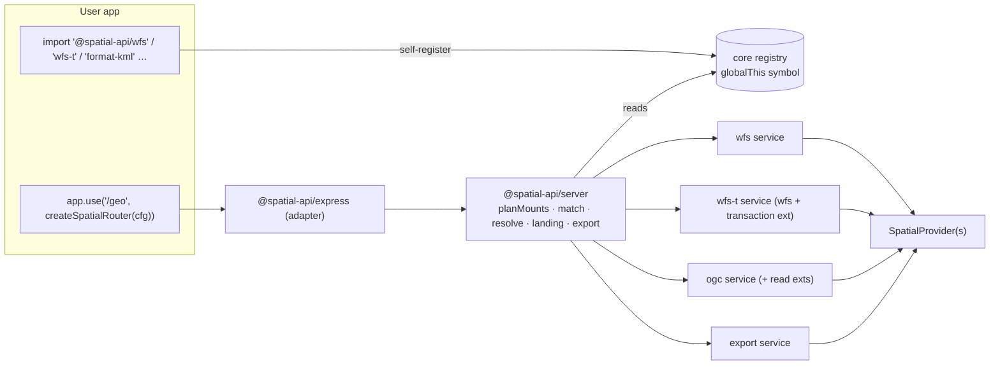

# Spatial-api 2.0 Registry, Extensions & Express Host

> Builds on: [Spec 1 — Provider Contract](2026-10-20-spatial-api-2-provider-contract.md). It needs `@spatial-api/core`, `SpatialService`, `SpatialRequest`/`SpatialResponse`, `FeatureEncoder` and `core/internal` `query()`.
> Source brief: [`briefs/2026-10-20-spatial-api-2-provider-contract.md`](briefs/2026-10-20-spatial-api-2-provider-contract.md). The rows marked "(Spec 2)" in its Resolved-unknowns table are binding.
> Release: this spec cuts the 2.0.0 `latest` release that Spec 1 holds back.

## 📝 TLDR

**Who needs it:** users who want installed spatial-api packages served without writing glue code, and every future extension or format package.

**After Spec 1:** each protocol is a framework-agnostic service, and users build, configure, adapt and mount each one by hand.

**Proposed (future behaviour):**
- Packages self-register on import into a registry in `@spatial-api/core`.
- Base protocols gain extension points: WFS-T plugs into WFS, and Parts 3, 4 and 5 plug into OGC.
- A framework-neutral `@spatial-api/server` turns `createSpatialServer(provider | config, options?)` into a plan of mounts. It implements the agreed precedence, write-protocol, resolver, logging, landing-page and `export` rules.
- A thin `@spatial-api/express` adapter (Express 4 and 5) exposes the server as `createSpatialRouter(...)`.

## 📝 Problem Statement

1. **Manual wiring for every service.**
   - After Spec 1, users build each service by hand, pass every encoder, and adapt `SpatialRequest`/`SpatialResponse` to their framework.
   - Each of the 9 planned packages adds more glue code.
   - An extension has no way to reach its base protocol, and a format has no way to reach the protocols, without that glue.
2. **No home for the agreed mounting behaviour.** The precedence rule, the write switch, path-parameter resolvers, the landing page and the export endpoint need one implementation. Re-implementing them in every app recreates the compatibility burden the programme is meant to remove.
3. **Framework code is scattered.**
   - Spec 1 removed the per-package Express routers. The Host-header and `trustedHosts` resolution that E01-S03 added inside each router (`wfs/src/index.ts` `resolveBaseUrl`) now has no owner.
   - So does reading the request body, which WFS used to get from `express-xml-bodyparser`.

## 📝 Proposed Solution

| Package | Role | Depends on |
|---|---|---|
| `@spatial-api/core` (extended) | Registry (`registerSpatialPackage`, `listRegistrations`) on a `globalThis` symbol, plus a built-in GeoJSON `FeatureEncoder` | — |
| `@spatial-api/wfs`, `@spatial-api/ogc` (extended) | An `extensions` option and the `WfsExtension` / `OgcExtension` interfaces; each registers itself on import | core |
| `@spatial-api/crs-transformer` (extended) | Registers itself as the default transformer on import | core |
| `@spatial-api/server` (new) | Framework-neutral host: config normalization, mount planning, path matching and params, provider resolvers, base URL and trusted hosts, body limit, logging, landing page (JSON + HTML), and the `export` service | core |
| `@spatial-api/express` (new) | Express 4/5 adapter, about 100 lines: request/response mapping, raw-body reading, streaming, abort | server; `express` as a peer dependency |

**Manual wiring without a host** is explicit and does not depend on the registry. Each package also exports a factory:

```ts
createWfsService({ provider, extensions: [wfsTransaction()], encoders: [shapefileEncoder()] })
```

The registry is read **only** by `@spatial-api/server`. Importing a package for manual use also registers it, which is harmless and has no effect without a server.

**Alternatives that lost:**
- **All logic in the Express package** (rejected in Q1). A second framework would mean a breaking change to the host.
- **Services reading the registry** (rejected in Q5). A service's behaviour would depend on imports made elsewhere in the app.
- **Scanning `node_modules` / probing package names.** Rejected in the brainstorm: fragile under bundlers and pnpm.
- **"First wins" on path collisions** (rejected in Q10). It silently drops an endpoint the user configured.

## 📝 Research — what market leaders do

- **GeoServer virtual services.** `/geoserver/{workspace}/wfs` exposes the same protocol per workspace, with separate data. This confirms that "several mounts of one protocol with different providers" is a real need, and path-scoped multi-tenancy is the established way to do it, not query parameters.
  - *Skip:* GeoServer's admin UI and catalog persistence. Our config is code.
- **pygeoapi.**
  - One server config maps resources to providers; protocols (OGC API Features, Records, …) are enabled server-wide. Its landing page lists collections and the API, as HTML and JSON through `f=`.
  - *Adopt:* JSON + HTML through content negotiation with an `f=` override.
  - *Skip:* the YAML config file.
- **Fastify plugins / `fastify-plugin`.** Explicit registration with encapsulation, and a name-based duplicate check (`fastify-plugin`'s `name` and `fastify` version range).
  - *Adopt:* a registration declares `id`, `packageName`, `version` and a compatible base range, and conflicts throw.
- **Express sub-apps / `app.use(path, router)`.** The user owns where the router is mounted, and the router only knows `req.baseUrl` at request time. So mount logs use paths relative to the router unless `basePath` is given (see Logging).

## 📝 Architecture



**Takeaway:** registration flows *into* core, and only the server reads it. Services never see the registry; the server constructs them with explicit `extensions`/`encoders`/`crsTransformer`. That makes the manual and hosted paths the same code. The Express adapter has no logic beyond mapping requests, so a future Fastify or Hono adapter is equally thin.

## 📝 Data Model

### Registry (in `@spatial-api/core`)

```ts
interface RegistrationBase { id: string; packageName: string; version: string;
                             registrySchema: 1 /* versioned separately from core's major */ }
interface ProtocolCreateOptions {
  provider: SpatialProvider; logger: Logger; crsTransformer?: CoordinateTransformer;
  encoders: FeatureEncoder[]; extensions: unknown[] /* attached by planMounts only */;
  limits?: ServiceLimits; options: Record<string, unknown> /* MountSpec.options, validated by the protocol */;
}
type Registration =
  | (RegistrationBase & { kind: 'protocol'; write: boolean;
      base?: { id: string; range: string /* semver range of the base package, e.g. '^2.0.0' */ };
      defaultPath: string /* = id */;
      parameters: ServiceInfo['parameters'] /* static metadata; landing page for resolver mounts */;
      create(o: ProtocolCreateOptions): SpatialService;
      requires?(provider: SpatialProvider): string[] /* violations */;
      errorResponse(err: ProviderError, req: SpatialRequest): SpatialResponse /* protocol-native error for server-side failures */ })
  | (RegistrationBase & { kind: 'extension'; target: string /* 'ogc' */; write: false;
      base: { id: string; range: string };
      create(options?: Record<string, unknown> /* MountSpec.extensions[id] when an object */): unknown;
      requires?(provider: SpatialProvider): string[] })
  | (RegistrationBase & { kind: 'format'; create(options?: Record<string, unknown>): FeatureEncoder })
  | (RegistrationBase & { kind: 'transformer'; create(): CoordinateTransformer });
```

**Storage and duplicate copies**
- **Storage.** `globalThis[Symbol.for('@spatial-api/registry')]` holds `{ registrySchema: 1, entries: Map<kind:id, Registration[]> }`.
- **Copies of core with the same `registrySchema`** share the map. This covers dual ESM/CJS loading and duplicate same-major installs.
- **A copy with a different `registrySchema`** throws `RegistryConflictError` when it loads.

**Registering the same `kind:id` again**
- Same `packageName` and same version: a no-op.
- Same `packageName`, different version, same major: the highest version is used, with a `warn` naming both install paths. Duplicated `node_modules` are common and not fatal.
- Different major, or a different `packageName` claiming the same id: `RegistryConflictError`.

**Errors across copies**
- Every `ProviderError` carries `[Symbol.for('@spatial-api/error')]: code`.
- The server and services classify errors by that brand, never by `instanceof`, which fails across ESM/CJS copies of core.

**Write protocols and extensions**
- **Write extensions register as protocols, not extensions.** `wfs-t` registers `{ kind: 'protocol', id: 'wfs-t', base: { id: 'wfs', range: '^2' }, write: true }`, and its `create` builds `createWfsService({ ...o, extensions: [wfsTransaction(), ...o.extensions] })`.
  - This is how separate keys, a pure `wfs`, and the two gates fall out of the model with no special cases.
  - `ogc-t` (Part 4) works the same way.
  - **Only `planMounts` attaches read extensions.** A protocol's `create` never adds them itself, so per-mount opt-outs always work.
- **Read extensions** (`ogc-part3`, `ogc-part5`) register as `extension` with `target: 'ogc'`. They auto-attach to every mount whose id or `base.id` is `ogc`, so `ogc` and `ogc-t` (Q3).
  - `MountSpec.extensions[id]` is `false` (off) or an options object, which is passed to `create(options)`. Future options, such as WFS locking durations, are therefore additive.
- **Version compatibility.** When planning, the installed base's version must satisfy the extension's or write protocol's `base.range`; otherwise `RegistryConflictError`. This is the dependency-mismatch trap the brainstorm identified.

**Packaging and tests**
- **`package.json`.** Every registering package builds `src/register.ts` as its **own esbuild entry** (`dist/register.js`, `dist/register.cjs`). The package entry imports it, and `"sideEffects"` lists exactly those two files. `scripts/check-dist.mjs` asserts every listed `sideEffects` file exists and that importing the package entry registers.
- **Test isolation.** `createSpatialServer` accepts `registrations?: Registration[]` (advanced/testing). It replaces the global registry for that server. Every package also exports its registration object (`wfsRegistration`, …), so tests build exact registries without relying on ESM import caching.

### Extension points (in `wfs` / `ogc`)

```ts
interface WfsExtension {
  id: string;
  operations: Record<string /* 'Transaction' */, (req: SpatialRequest, ctx: WfsRequestContext) => Promise<SpatialResponse>>;
  capabilities?(c: WfsCapabilitiesContext): { operations?: OperationMetadata[]; constraints?: Record<string, string> };
  requires?(provider: SpatialProvider): string[];
}
interface OgcExtension {
  id: string;
  conformanceClasses: string[];
  routes?: { method: SpatialRequest['method']; pattern: string /* '/collections/{collectionId}/items' */;
             handler(req: SpatialRequest, ctx: OgcRequestContext): Promise<SpatialResponse> }[];
  queryParameters?: OpenApiParameter[];                       // documented in /api, accepted by /items
  filterLanguages?: Record<string /* 'cql2-text' */, (text: string) => Filter>;
  openapi?(doc: OpenApiDocument): void;
  requires?(provider: SpatialProvider): string[];
}
```

- An extension route that collides with a base route or another extension's route throws at service creation. For example, Part 4's `POST /collections/{id}/items` is legal because the base defines only `GET`.
- **Shared resources are contributed, not routed.**
  - `/collections/{id}/queryables` is owned by the base `ogc` package and served whenever any extension contributes to it. Part 3 and Part 5 each add an `OgcExtension.contribute.queryables?(collection, current)` instead of a route.
  - The same applies to `conformanceClasses` and `openapi`.
- **Response hooks.** `OgcExtension.onResponse?(req, res, ctx)` and `WfsExtension.onResponse?` may add headers to base responses; for example, Part 4 sets `ETag` on `GET /items/{id}` and checks `If-Match` through its own write routes. A hook may not replace the body. Without this hook, the extension model would be too narrow for Part 4.
- `ctx` gives an extension its base's internals in a controlled way: the `query()` pipeline, the exception builder, encoders, `baseUrl` and the logger. Extensions don't re-implement them.

### Server config

```ts
type ProviderResolver = (ctx: { pathParams: Record<string, string>; user?: unknown; protocol: string }) =>
                        SpatialProvider | Promise<SpatialProvider>;
type ProviderRef = SpatialProvider | ProviderResolver;                  // object vs function — unambiguous
interface MountSpec { provider?: ProviderRef /* defaults to top-level provider; error if neither */;
                      path?: string /* default = id; REQUIRED for every element when the value is an array of length > 1; may contain ':param' segments */;
                      options?: Record<string, unknown> /* protocol factory options, e.g. enabledVersions, defaultLimit */;
                      extensions?: Record<string, false | Record<string, unknown>>;
                      formats?: Record<string, false | Record<string, unknown>>; maxBodyBytes?: number }
interface ServerConfig {
  provider?: ProviderRef;
  protocols?: Record<string, ProviderRef | MountSpec | (ProviderRef | MountSpec)[] | false>;
  enableWriteProtocols?: boolean;
  logger?: Logger | false; basePath?: string /* only used in log lines */;
  baseUrl?: string /* absolute → used verbatim (+ mount path) */; trustedHosts?: string[];
  crsTransformer?: CoordinateTransformer | false /* default: registered transformer, if any */;
  maxBodyBytes?: number /* default 10 MiB */; landingPage?: boolean /* default true */;
  limits?: ServiceLimits; getUser?: (nativeReq: unknown) => unknown;
  registrations?: Registration[] /* advanced/testing: replaces the global registry for this server */;
}
createSpatialServer(x: ProviderRef | ServerConfig, options?: Omit<ServerConfig, 'provider'>): SpatialServer
interface SpatialServer { handle(req: SpatialRequest): Promise<SpatialResponse | undefined /* not matched */>; mounts: MountInfo[] }
createSpatialRouter(x, options?): express.Router      // @spatial-api/express; same overloads
```

### Mount planning: `planMounts(config, registry)`

A pure function, run once at creation.

1. **Normalize.**
   - If `x` is a `ProviderRef`, treat it as `{ provider: x, ...options }`.
   - If `x` is a config and `options` is also given, throw. Two sources of truth is a usage error.
2. **Check `protocols` keys.** Each key must be a registered `protocol` id, otherwise throw `UnknownProtocolError` listing the installed ids. If a write protocol is listed while `enableWriteProtocols === false`, throw.
3. **Explicit mounts.** Each `protocols[id]` that isn't `false` becomes one or more mounts. A bare `ProviderRef` becomes `{ provider }`. A missing provider falls back to the top-level `provider`; if there is none, throw.
4. **Auto mounts.** When a top-level `provider` exists, every registered protocol whose id is **not** a key of `protocols` (keys set to `false` count as present) is mounted on its `defaultPath`, provided either:
   - `write === false`, or
   - `enableWriteProtocols === true`.
5. **Attach read extensions.**
   - Every registered extension whose `target` equals the mount's id or its `base.id` is attached, unless the mount sets it to `false`. An options object is passed to `create`.
   - An unknown key in `MountSpec.extensions` throws.
   - The base version is checked against `base.range`.
6. **Inject formats and the transformer.**
   - Every registered `format` is passed as an encoder unless the mount sets it to `false`; an unknown key throws. The core GeoJSON encoder is always present.
   - Two formats with the same `fileExtension` or WFS `outputFormat` name throw `RegistryConflictError`.
   - `crsTransformer` comes from config, otherwise from the registered `transformer`, otherwise none. `false` forces none.
7. **Check paths.**
   - Normalize them: strip slashes, and lower-case only the static segments.
   - Two mounts **overlap** when one path, segment by segment, is a prefix of the other, with `:param` segments matching anything. Overlapping mounts throw `MountConflictError` naming both.
   - So a root mount (`''`) is legal only as the **only** mount, and it disables the landing page with an `info` log.
8. **Gate static providers.** For each mount with a provider instance: run `validateProvider` (Spec 1), the registration's `requires(provider)` and each extension's `requires`, and collect *all* violations. For example, `wfs-t` needs `capabilities.write` and `transaction`. Any violation throws `MountValidationError`.
9. **Create and log.** Create the services, then log one `info` line per mount: `[spatial-api] mounted wfs-t at {basePath ?? '<router>'}/wfs-t — WFS 1.0.0,1.1.0,2.0.2 + Transaction; formats geojson,gml,shapefile; provider roads-pg`. Capability findings are logged as `warn`. Registrations arriving *after* `createSpatialServer` get a `warn` once: "registered after server creation; not mounted".

### Provider resolvers

- Called per request with `pathParams`, `user` and `protocol`.
- **Cache.** `WeakMap<provider, Map<mountId, SpatialService | Violations>>`. Each (provider, mount) pair is gated separately, so a provider validated for `wfs` is still gated for `wfs-t`. Violations are cached too, so repeat requests fail fast.
- **Quiet creation.** Services created for resolved providers log at `debug`, not `info`; the mount's `info` line is written once at startup with its `:param` template.
- **Docs.** Resolvers should return **stable instances**, for example a map of tenant to provider. A resolver that builds a new provider per request works, but pays validation and service creation every time. The docs say so.
- **Errors** are rendered by the registration's `errorResponse(err, req)`, so a WFS mount answers with a WFS ExceptionReport and an OGC mount with OGC JSON.
  - A branded `NotFoundError` (for example an unknown `:tenant`) → the protocol's 404.
  - A resolved provider that fails the gate → 500 with the generic internal message, plus an `error` log naming the mount and the violations. It can't throw at startup, because it is only known at request time.

## 📝 API Contracts

### Base URL

- `baseUrl` absolute → `baseUrl + '/' + mountPath`.
- Otherwise the adapter supplies the request's scheme, Host header and router base. The server validates the host with E01-S03's rules (`HOST_REGEX` / IPv6 / case-insensitive `trustedHosts`) and builds `scheme://host + routerBase + '/' + mountPath`.
- Without `trustedHosts`, any well-formed Host header is accepted, and a startup `warn` recommends `trustedHosts` or an absolute `baseUrl` (Q6).
- **An invalid or untrusted host** falls back to a **path-absolute** base (`routerBase + '/' + mountPath`, with no scheme or host). The request is still served, and the untrusted host is never reflected. This is E01-S03's current behaviour (`ogc/src/index.ts:142-152`, asserted by `ogc/test/security.test.ts` and `wfs/test/host-security.test.ts`).
  - Amend Spec 1: `SpatialRequest.baseUrl` is "absolute or path-absolute".
- **Scheme** comes from the adapter: Express's `req.protocol`, which honours the app's `trust proxy` setting. The README documents setting `trust proxy` behind TLS-terminating proxies, or using an absolute `baseUrl`.

### Body

- The adapter reads the raw body up to `maxBodyBytes` (mount override, otherwise global, default 10 MiB) and returns **413** beyond that, before any parsing.
- Whether the stream was consumed is detected from the stream itself (`req.readableEnded`, or body-parser's `req._body` flag), **never** from `req.body` being set: Express 4 body-parser sets `req.body = {}` even on requests it didn't parse.
  - **Not consumed:** the adapter reads the raw body itself.
  - **Consumed, with a `Buffer` or string `req.body`:** it is used as-is.
  - **Consumed, `application/x-www-form-urlencoded`** (legal for WFS KVP over POST): re-serialized with `URLSearchParams`.
  - **Consumed, `application/json` / `application/geo+json`** (Part 4): re-serialized with `JSON.stringify`.
  - **Consumed, any other type** (for example XML parsed by an XML body parser): 500, with an `error` log saying "mount spatial-api before XML body parsers or use express.raw()".

### Landing page

`GET {router}/` with `landingPage !== false` and no root mount.

**JSON:**

```json
{ "title": "spatial-api", "nonStandard": true,
  "mounts": [{ "id": "wfs", "kind": "protocol", "path": "wfs", "href": "https://h/geo/wfs?service=WFS&request=GetCapabilities",
               "write": false, "versions": ["1.0.0","1.1.0","2.0.2"], "extensions": [], "formats": ["geojson","gml"] }] }
```

**Allowed parameters.** Every mount entry carries `parameters`.
- **Static-provider mounts** take them from the service's `describe().parameters` (Spec 1 `ServiceInfo`).
- **Resolver mounts** take them from the static `parameters` of the registration and its attached extensions. No service exists until a request arrives, so vendor parameters are not listed for these mounts.

Either way, the list comes from the same tables the parsers use, so it cannot drift from them. Each entry is shaped `{ name, in: 'query' | 'path', operations?: string[], required: boolean, description, example?, source: 'standard' | 'extension' | 'vendor', specUrl? }`. For example:

| Mount | Parameters listed |
|---|---|
| WFS | `SERVICE`, `VERSION`, `REQUEST`, `TYPENAMES`, `BBOX`, `FILTER`, `SRSNAME`, `COUNT`/`MAXFEATURES`, `STARTINDEX`, `OUTPUTFORMAT`, `RESOURCEID`/`FEATUREID`, … per operation |
| OGC | `bbox`, `bbox-crs`, `crs`, `datetime`, `limit`, `offset`, `f`, `properties`, plus extension parameters such as `filter` and `filter-lang` from Part 3 |
| export | its full strict list |

Vendor parameters a provider declares (Spec 1) are listed with `source: 'vendor'`.

**HTML.** Served when `Accept` prefers `text/html` or `f=html`; `f=json` forces JSON. It is a static, escaped page built from the same data. **For each mount it shows:**
- what the endpoint is: protocol, versions, read or write, formats
- its entry URL
- a table of **allowed parameters** with name, required, description, example, and which operations accept it
- a link to the standard's document for standard parameters

The `export` section also shows a worked example URL per format.
- Headers: `Content-Security-Policy: default-src 'none'; style-src 'unsafe-inline'`, `X-Content-Type-Options: nosniff`.
- No scripts.
- The only provider-originated text is the vendor parameter descriptions a static provider declares, and they are HTML-escaped. No collection data and no user data are rendered.
- Resolver mounts show their `:param` template, and `href` is omitted.

### `export` service

The `export` service is registered by `@spatial-api/server` (id `export`, read), and `createExportService` is exported for manual use.

| Request | Response |
|---|---|
| `GET {export}/` | JSON list `{ collections: [{ id, title, formats: [{ id, href, mediaType }] }] }` |
| `GET {export}/{collection}.{ext}` or `GET {export}/{collection}?f={encoderId}` | The encoded file, with `Content-Type` from the encoder and `Content-Disposition: attachment; filename="{collection}.{ext}"` |

**Query parameters**, using OGC API Features Part 1/2 semantics:
- `bbox`, `bbox-crs`, `crs`
- `datetime`, which needs a `temporalProperty`
- `limit`: the default and maximum are `maxFeatures`, default 100 000. Out-of-range or non-integer values get 400.
- `properties`: a comma list for selection
- `{property}={value}`: equality, only for `queryable` properties, with values coerced by `PropertySchema.type`. Unparseable values get 400.

**Every other parameter gets 400.** We own this endpoint, so it is strict.

**Encoder limits** (`singleGeometryType`, `geometryTypes`, `maxFeatures`) are checked against the `CollectionDescription` *before the first byte*. A violation gets 400 naming the limit.

**Scan cap.** Export goes through Spec 1's `query()`, so with a residual filter or a non-paging provider, `limits.maxScan` (default 10 000) bounds the features *examined*, independently of `maxFeatures`. Exceeding it before the first byte gets 400 "refine the filter". The README states that bulk exports need a provider with native paging and native support for the filters used.

**Responses:**
- `OGC-NumberMatched` is sent when known and no residual filter exists.
- Encoding errors after headers are sent abort the stream. The client sees a truncated download, and an `error` log is written.

### Express adapter (`@spatial-api/express`)

- **Mapping.** `req.path` (relative to the router) goes to `SpatialRequest.path`. `req.query` (Express's parser output, normalized to `string | string[]`) goes to `query`. Other fields:

  | Field | Source |
  |---|---|
  | headers | lower-cased |
  | `user` | `getUser(req)`, default `req.user` |
  | `signal` | an `AbortController` aborted on `res.on('close')` before finish |

  `baseUrl` is built as described under Base URL.
- **Response.** `body` as a string or `Uint8Array` goes to `res.end`. An `AsyncIterable` is piped through `Readable.from` with backpressure.
- **Unmatched requests** go to `next()`.
- **Compatibility.** `express` `^4 || ^5` as a peer dependency (Q2). There's no dependency on `express-xml-bodyparser`.
  - npm workspaces hoist one Express version, so CI adds a second job that runs `npm i express@4 --no-save` before the adapter and e2e tests.
  - The default job runs Express 5.

## 📝 Documentation

Documentation is part of the deliverable, not a follow-up. Every step that changes a package's public behaviour updates that package's README in the same step.

**Root `README.md`:**
- what spatial-api is
- a **package matrix**: package, role, standalone use (yes / with companion / no), required companions, typical install line
- a 5-line quick start with the Express host, and the same without a host
- links to every package README, the migration guide, `docs/standards/README.md` and the provider-author guide

**Every package `README.md`** follows one checklist:
1. **What it is.** The standard and versions implemented, with links to the official documents.
2. **Can I use it on its own?** One of:
   - *Standalone*, with a minimal example (for example `createWfsService` plus a hand-written adapter for any framework).
   - *Needs companions*, naming exactly which packages and why. For example, `wfs-t` installs `wfs` automatically and needs a provider declaring `capabilities.write`; `express` needs `server`, which it installs.
   - *Not for direct use*, as a tooling or internal package: what it is for, and which package to install instead. For example, `core` is for provider authors and package authors (its `internal` subpath is never for users), and `tester` is a CLI.
3. **Install** line(s), including peer dependencies.
4. **Usage with the host**: the config key, default path, and whether it is auto-mounted.
5. **Usage without the host**: the explicit factory, `extensions`/`encoders` wiring, and the logger option.
6. **Provider requirements**: required and optional capabilities, and what happens when a capability is missing (fallback or startup error).
7. **Parameters and endpoints** it accepts: the same data the landing page shows.
8. **Conformance**: a link to its suite and its known gaps.

**Specific to this spec:**
- the server and express READMEs carry a worked example for *every* row of the mounting rules (default provider, `protocols`, `false`, arrays, resolvers, the three `enableWriteProtocols` states)
- the registry and the `Registration` shape are documented for third-party package authors

**Every per-package spec** (A, B, C) must carry this checklist in its own plan.

## 📝 Edge Cases & Failure Scenarios

| Scenario | Behaviour |
|---|---|
| `protocols: { wfs: … }` while `wfs` isn't installed | Throws `UnknownProtocolError: 'wfs' not registered — installed: ogc, export`. The common cause, a missing import, is named in the message. |
| `wfs-t` listed with a provider that can't write | Throws `MountValidationError` (gate 2). |
| `enableWriteProtocols: false` with `protocols: { 'wfs-t': p }` | Throws (kill switch). |
| A default provider, `wfs-t` installed, `enableWriteProtocols` unset | `wfs` is auto-mounted; `wfs-t` isn't. An `info` log says "write protocol wfs-t installed but not mounted (enableWriteProtocols unset)". |
| `wfs: false` | Not mounted, even with a default provider. |
| Two mounts at `roads/wfs` | `MountConflictError` at startup. |
| `:tenant/wfs` and `admin/wfs` | Conflict: the param segment overlaps the static one. The user must use distinct static prefixes, e.g. `t/:tenant/wfs`. |
| A resolver returns an invalid provider | 500 with the generic message, rendered by the protocol's `errorResponse`, plus an `error` log with the violations. Repeat requests with the same instance and mount fail fast from the cached violations. |
| A resolver rejects (an unknown tenant) | Its `NotFoundError` becomes the protocol's 404. Other errors become a 500. |
| Two `@spatial-api/core` copies with different `registrySchema` in one process | `RegistryConflictError` when the second loads, naming both package paths. |
| Two same-major copies of `wfs` (e.g. 2.0.1 and 2.1.0) | The highest version is used, with a `warn` naming both install paths. |
| `wfs-t@2` with `wfs@3` installed | `RegistryConflictError` at import. |
| A body over the limit | 413 before parsing. |
| The client disconnects during export | `signal` aborts, the encoder stops pulling, and the provider stream is closed. |
| `export` with no format package installed | The built-in GeoJSON encoder (Q8) still works, so `export` is always usable. |
| A collection id containing `.` (e.g. `roads.v2`) | `/{collection}.{ext}` splits on the *last* `.` and matches only registered extensions. `?f=` always works. |

## 📝 Risks & Impact Review

- **New public contracts.** `registerSpatialPackage` and the `Registration` shape become the plugin API for third parties. They are hard to change after 2.0.0, so they are listed in `BACKWARD_COMPATIBILITY.md`.
- **Global state.** The registry is process-global by design (the brainstorm decision). Tests need `__resetRegistryForTests()`, exported only from `core/internal`.
- **The import-side-effect footgun.** Forgetting `import '@spatial-api/x'` means the package is silently not mounted. This is mitigated by:
  - `UnknownProtocolError` for explicit keys
  - the mount log listing exactly what was mounted
  - the landing page
- **Security.**
  - Write protocols are never auto-mounted unless enabled.
  - A host-header failure gets 400.
  - The body limit is checked before parsing.
  - The landing-page HTML is escaped and served under a strict CSP.
  - `export` caps features and rejects unknown parameters.
- **Express 4 and 5 differences.** Path syntax and `req.query` parsing differ. The adapter avoids Express routing patterns entirely (it uses `router.use` with its own matcher) and normalizes `query`.
- **Release.** At the end, every package goes to 2.0.0 and is published under `latest` in the order core → crs → wfs → ogc → server → express → tester.
  - **Rollback, packages with a 1.x:** run per package, for example `npm dist-tag add @spatial-api/wfs@1.1.2 latest`, for `crs-transformer`, `wfs`, `ogc` and `tester`, then `npm deprecate` on their 2.0.0.
  - **Rollback, new packages** (`core`, `server`, `express`): they have no 1.x to fall back to, so they are only deprecated.

## 📋 Phasing

| Phase | Outcome | Shippable state |
|---|---|---|
| 1 | Registry in core + built-in GeoJSON encoder; wfs/ogc/crs register on import | Registry unit tests; services unchanged in behaviour |
| 2 | Extension points in wfs/ogc (`extensions` option, interfaces), proven with test-only dummy extensions | WFS/OGC conformance green; dummy extension tests green |
| 3 | `@spatial-api/server`: normalization, `planMounts`, matcher, resolvers, base URL, body limit, logging | `planMounts` decision-table tests green |
| 4 | Landing page (JSON + HTML) and `export` service | Landing and export tests green |
| 5 | `@spatial-api/express` adapter; Express 4/5 CI matrix | Adapter tests on both majors |
| 6 | Conformance, e2e and tester suites run through the real host; docs; 2.0.0 release | Full gate green; 2.0.0 published as `latest` |

## 📋 Implementation Plan

**Phase 1 — registry**
1. In core: `registry.ts` with `registerSpatialPackage`, `listRegistrations`, `RegistryConflictError`, the `globalThis` symbol with a `registrySchema` check, and error branding via `Symbol.for('@spatial-api/error')`. Test:
   - sharing across simulated copies
   - a different schema → throws
   - an idempotent re-register
   - same package, higher same-major version wins with a warn
   - a different package claiming the same id → throws
   - errors are classified across two simulated core copies
2. In core: `encoders/geojson.ts`, the built-in streaming RFC 7946 encoder (amends Spec 1 step 10). Test: streaming output parses as valid GeoJSON, multi-layer is rejected (`multiLayer: false`), abort stops output, plus the RFC 7946 conformance suite run on encoder output.
3. Add `register.ts` as its own esbuild entry to wfs, ogc and crs-transformer. Each also exports its registration object, with static `parameters` and `errorResponse`, and declares `sideEffects`. Switch their GeoJSON output to the core encoder. Test: importing each package registers the expected entries; the WFS/OGC/RFC 7946 suites stay green; `check-dist` confirms the `sideEffects` files exist and registration happens from both the ESM and CJS builds.

**Phase 2 — extension points**
4. In wfs: the `WfsExtension` type and the `extensions` option. Dispatch consults extension operations after built-ins; a name collision throws at creation; extension capabilities are merged into GetCapabilities for all versions. Test: a dummy `Echo` operation is advertised and dispatched; a collision throws; `requires` violations throw.
5. In ogc: the `OgcExtension` type and the `extensions` option. This covers:
   - route merging with collision checks
   - conformance class merging
   - query parameters accepted by `/items` and documented in `/api`
   - `filterLanguages`
   - the `openapi` hook
   - `contribute.queryables`, with the base serving `/queryables` when contributed
   - `onResponse` header hooks

   Test: a dummy extension adds a route, a conformance class, a parameter, a queryables contribution and an `ETag` header, and `query-param-unknown` still rejects undeclared parameters. Two dummy extensions contributing queryables are merged, not collided.

**Phase 3 — server**
6. Scaffold `packages/server` (dual build, `"files": ["dist"]`, publish step) with config normalization and validation. Test: both call forms are equivalent; config plus options throws; bad types throw with readable messages.
7. Add `planMounts`. Test: a decision table covering every brief row:
   - default provider with and without `protocols`
   - `false` entries, and array mounts (missing `path` → throws)
   - the three `enableWriteProtocols` states
   - read extensions: off, or with options
   - format opt-outs and duplicate format extensions
   - transformer selection
   - unknown keys, at protocol, extension and format level
   - segment-prefix overlap and param overlap
   - a root mount only as the sole mount
   - a base-range mismatch
   - static gate failures collecting every violation
8. Add the matcher and request handling: `:param` extraction, the resolver flow with the per-(provider, mount) cache and quiet creation, `errorResponse` rendering, base URL with `trustedHosts` and a path-absolute fallback, the body-limit contract, and mount logging and late-registration warnings. Test:
   - resolver errors → protocol-native 404 or 500
   - one provider gated separately for `wfs` and `wfs-t`
   - the E01-S03 host-security cases ported from `host-security.test.ts` and `ogc/test/security.test.ts` (no reflection, path-absolute fallback)
   - log lines checked through a capture logger
   
   Also add `server` to `publish.yml`.

**Phase 4 — landing and export**
9. Landing page JSON and HTML with content negotiation, `f=`, CSP and escaping, plus the per-mount **allowed-parameters** table built from `describe().parameters`. Test:
   - snapshots
   - the table equals the parser tables. This is checked by diffing `describe().parameters` and the registration's static `parameters` against the KVP and query tables each parser exports to its tests. Probing isn't enough, because WFS tolerates unknown KVPs.
   - an XSS probe through a provider-declared vendor parameter description, which must be escaped
   - disabled when off or when a root mount exists
10. The `export` service and its registration. Test:
    - each query parameter, including 400 cases and unknown-parameter rejection
    - the `{collection}.{ext}` split for dotted ids
    - `Content-Disposition`
    - encoder limits checked before the first byte
    - the `maxFeatures` cap
    - `OGC-NumberMatched`
    - abort mid-stream

**Phase 5 — express adapter**
11. Scaffold `packages/express` with request and response mapping, raw-body reading up to the limit, consumed-stream detection, form and JSON re-serialization, streaming with backpressure, abort on close, and `next()` when unmatched. Add `express` to `publish.yml`, and add the Express 4 CI job (`npm i express@4 --no-save`). Test, with supertest on both majors:
    - a 413 at the limit
    - a WFS XML POST behind a global `express.json()`, which must succeed
    - a urlencoded WFS POST behind `express.urlencoded()`
    - an XML body pre-parsed by an XML parser → 500 with the advice log
    - a streamed export
    - a client abort

**Phase 6 — through the real host, docs, release**
12. Switch the conformance and e2e suites (`packages/*/test/conformance`, `wfs/test/http-e2e.test.ts`, `tester` e2e) from the per-package test harnesses to `createSpatialRouter`. Delete the harnesses. This step *is* the pluggability proof. Test: the full suite is green, with the same pass and gap counts as before.
13. Docs, per the **Documentation** section below: the root README, every package README, the migration guide update (routers → host), `BACKWARD_COMPATIBILITY.md` sections for the registry, server and express, and the AGENTS.md package list. Test: the README checklist (below) is ticked for every package in the PR description; code blocks in READMEs are compiled by a `docs:check` script (extract them, then `tsc --noEmit`).
14. Bump everything to `2.0.0` and publish under `latest` in dependency order. Test: `npm test`, `npm run build`, `npm run test:dist`, and a publish dry-run.
